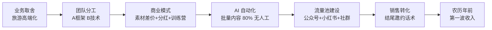

# 2026-11-17 战略对话 · 核心内容纪要

| 项目 | 内容 |
|---|---|
| 主题 | 业务方向选择、团队分工、AI 自动化内容分发、流量与转化打法 |
| 类型 | 两人创业战略对话（合伙人一对一） |
| 录音时间 | 2026-11-17 13:31（约 34 分钟） |
| 参与人 | A（方向/产品/框架主导）、B（技术落地主导） |
| 核心结论 | **旅游做高端、AI 做批量内容分发、课程做产品化；A 出框架 B 管技术落地，目标 80% 自动化；农历年前靠「持续更新 + 持续参加活动 + 持续约人」跑通第一波收入** |

## 一、业务取舍：旅游砍低端、做高端，境外暂缓

- **大团低价团不推**：如泰国 1999 元/人、人头仅赚 50 元，虽利润尚可，但购物点多、体验差、**客诉率高**，不值得做。
- **主攻高端定制**：泰国线做 8000 / 1 万 / 2 万每人档位，避开低价内卷。
- **境外板块保留**：怎么打还没想清楚，暂放保留区，前提是「视频可以批量做」才可行。
- **长期愿景**：回归老本行——带一群人出去玩，每年复购的都是自己人。

## 二、三条业务线并行

- **旅游**（核心）、**AI**、**心理咨询**三块想一起做，做成后可搭自己的平台。
- 带货板块：有「好好生活俱乐部」（家人负责），属私域带货，用户直接向平台购买，团队暂不投入，但认定为**未来稳定区块**；朋友的抖音带货项目不并入。

## 三、团队分工与机制

- **A 的角色 = 产品经理/主管**：构思想法、搭框架，之后交出去，**不再陷入「执行+推进+落地」全包的陷阱**。
- **B 的角色 = 技术负责人**：把框架以**最小成本快速落地**，负责自动化。
- 团队还需补：**内容人才、技术人才、交付人才**（业务端交付，懂业务、能带人跑，A 可协助培训）；方向与培训人才不外招。
- 机制：在公司体系下像「自己的子公司」，**利益共同挂钩、利润一起分**。
- 本周先招人，初步可启动**约 10 人**团队；基本功训练是统一前提。

## 四、商业模式与利润点（数字均来自对话）

- **素材差价**：视频成片成本约 5 元/条，对外售 8 元，单条利润约 3 元。
- **分红**：团队利润分成。
- **训练营/陪跑**：以「旅行家」等名义招募，试跑 3 个月收费，知识付费模式；另规划 **399 元训练营**（航海形式、带一个月），向二阶三阶课导流，课程要**产品化**。
- **抖音带货参照**：第三个月起每人每月可赚几百元；成熟号月净收入约 **8000–15000 元**，月成本约 800 元，投入产出划算，可以跑。
- **知识付费现实**：航海类项目真正赚到钱的人约 **20%**，属常态——所以群规模要小、认真带，前期把规则讲清楚。
- **判断**：低质量内容带货只能赚小钱，兴趣不大；要做**高质量内容分发 → 导入自己的交付体系**，收入才高且稳定。

## 五、AI 自动化战略（B 的主战场）

- **总目标：所有技术做到 80% 自动化，人工尽量不介入**。
- 打法：同一视频换人、改字即可批量分发（多号矩阵），做「相同属性的高质量内容」。
- **竞争判断**：小红书上能做这事的人很少——会用 Claude 等 AI 工具的人本就不多，会用的都去做专业编程，看不上发小红书，**存在 2–3 年红利期**。
- 导流逻辑：所有分发最终导向一个纯 AI 的 IP 账号；找 IP 感强的人合作，团队供素材、他发内容，号做起来接单可抽成。
- 资源：团队共用公费 AI 账号（A 的电脑环境快备好）。
- 有意参加**上海 AI 比赛**攒经验与背书（有学生想组队，A 犹豫是否带人）。

## 六、流量池与转化方法论

- **从上班到副业的第一步，任何人都绕不开：拥有自己的流量池**（小红书/抖音/公众号/私域）。
- 公众号读者产值低，必须有明确引流手段（A 曾靠公众号+社群半年变现几十万）。
- **AI 服务供不应求**：有需求的人很多、会 AI 的人很少（对话中估算约 10:1），要持续输出「AI + 各行业」主题。
- 现有盘子：公众号 600+ 关注、每天约 3 人进群；AI 免费群约 50 人（约 25 人自然流入）；小红书群 62 人；自媒体渠道约 6 人——若转化即可回本。
- **对外展示很重要**：一个月做出 2000+ 关注的号并接 3 个广告，是极有说服力的名片。
- 保持更新频率 → 有固定关注 → 再思考留存；旅游小红书群持续发内容约一个月来一单；号可换主题，粉丝量还在。

## 七、销售/邀约基本功（B 当前最缺的环节）

- **聊天必须有结尾**：固定收尾话术——「都在杭州，有没有机会一起喝咖啡 / 来公司，我介绍合伙人给你认识」。**成交不一定是卖东西，提出需求、对方答应就是成交**。
- **约时间诀窍**：不问「你哪天有空」，而是给具体二选一（如「周二上午或周四下午」），不行再让对方给时间；约好后发位置。
- 微信聊天超过 10 句，基本都能约出来。
- 对存量好友可重新激活：「上次聊到忘了约你喝咖啡，你什么时候空？」
- 第一次见面不必带明确目标，先建立熟悉度，再评估是否追踪。
- 节奏：每周约 3–4 人来公司聊，公司无额外成本。

## 八、B 的副线：高校 AI 就业平台

- 与朋友公司讨论中：面向有就业指标压力的高校（尤其职业院校），搭 AI 平台教学生就业技能。
- 模式：把已有项目包装进平台，**一次性 30–50 万卖给学校**，可附加代教服务。
- 特点：学校交付要求不高（花经费 + 要案例口碑），不像商业公司要求业务完全跑通；但学校/机构谈判周期长，目前尚无结果。

## 后续待办（To-Do）

- [ ] 本周启动招人，搭约 10 人初始团队 —— A
- [ ] 出整体框架，并今晚先小范围启动训练营招生（边跑边招） —— A
- [ ] 技术框架最小成本落地 + 搭建自动化分发体系（目标 80% 自动化） —— B
- [ ] 持续更新账号（每天约 1 小时）、持续参加活动、持续约人（每周 3–4 人） —— B
- [ ] 对存量好友用「喝咖啡」话术重新激活邀约 —— B
- [ ] 拉 B 进 AI 群，共同运营小红书训练营 —— A
- [ ] 评估是否参加上海 AI 比赛 —— A
- [ ] 跟进高校平台谈判进展 —— B

---

> 备注：本纪要由 ASR 转写整理，个别人名、数字可能存在识别误差，关键决策前建议回听原录音确认。
