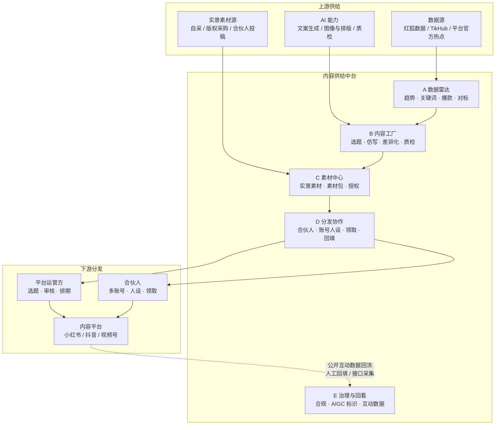

# 高端旅游内容供给中台 · 产品方案

**版本** v0.1 ／ **日期** 2026-11-21 ／ **状态** 待评审

> **一句话定位**：面向高端旅游内容分发网络的「内容供给中台」——把选题、生产、素材、分发、回看做成一条可管理的内容生产线。
>
> **产品形态**：Web 工作台（生产与管理）＋ 移动 H5（合伙人领取与发布），小程序作为二期轻入口。
>
> **本期不做**：交易与结算类能力（订单、支付、结算）完全不涉及；不做自动发布、自动互动、AI 托管；不做通用全行业工具。

---

## 摘要：一页看懂

| 项目 | 结论 |
|---|---|
| 需求本质 | 不是要一个「仿写工具」，而是要**稳定、可持续、差异化的内容供给能力** |
| 产品形态 | 从单点工具升级为**中台**：统一数据、统一生产、统一素材、统一分发、统一治理 |
| 服务对象 | 平台运营方（生产与管理）＋ 合伙人（领取与发布） |
| 业务垂类 | 高端旅游（先做深一个垂类，再谈横向复制） |
| 核心资产 | 实景素材库 ＋ 差异化改写能力 ＋ 合伙人账号人设档案 |
| 北极星指标 | **周有效内容产出**＝被发布且完成回填的内容数 |
| 最大风险 | 平台同质化治理与 AIGC 合规，而非技术实现 |

**三条设计原则**

1. **人机协同，不做托管**：系统负责供给，人负责发布与判断。
2. **差异化优先于产量**：宁可少发，不可同质。
3. **素材是资产，模型是能力**：模型可替换，素材与账号人设是壁垒。

---

## 1. 背景与产品结论

### 1.1 需求本质

原始需求可以概括为：平台方提供内容素材，其他人用各自账号发布，平台负责供给与组织。拆开看，它包含三件事：

1. **看得见**：知道各平台现在什么内容在火、什么关键词有机会。
2. **产得出**：能围绕高端旅游稳定产出可发布的图文/视频内容。
3. **发得动**：能把内容按账号人设分发给多个合伙人，并回收发布情况。

用户以为自己要的是「一键仿写」，实际缺的是**组织化供给能力**。仿写只解决第 2 件事的一个环节，无法解决选题、素材、差异化和多人协作。

### 1.2 产品结论

- **做中台，不做单点工具**：工具解决个人效率，中台解决组织供给。
- **只做内容供给，不碰交易**：本期产品边界止于「内容发布与效果回看」，不进入订单、支付、结算。
- **垂类优先**：高端旅游的内容门槛在实景素材与调性，通用工具无法覆盖，垂类中台反而更容易建立壁垒。

### 1.3 与「仿写助手」的区别

| 维度 | 仿写助手 | 内容供给中台 |
|---|---|---|
| 核心用户 | 单个创作者 | 平台运营方 ＋ 多个合伙人 |
| 核心能力 | 输入主题→生成一篇 | 选题→生产→素材→分发→回看 |
| 组织模型 | 一个用户一份定位 | 组织→合伙人→多账号人设 |
| 内容资产 | 用完即走 | 素材库、版本、授权、发布记录 |
| 治理能力 | 基本没有 | 合规、差异化、限频、审计 |
| 价值主张 | 写得快 | 供得稳、发得开、管得住 |

---

## 2. 用户角色与需求边界

### 2.1 用户角色

| 角色 | 核心职责 | 核心诉求 | 主要使用端 |
|---|---|---|---|
| 平台运营 / 内容主编 | 定选题、排期、把控调性 | 知道发什么、产能稳定、内容不跑偏 | Web 工作台 |
| 内容编辑 / 生产 | 拆解、仿写、改写、配图 | 少重复劳动、一次生成多版本 | Web 工作台 |
| 审核 / 合规 | 内容审核、风险拦截 | 规则可配置、留痕可追溯 | Web 工作台 |
| 合伙人 | 领取素材、用自己的账号发布 | 今天发什么、复制就能用、简单 | 移动 H5（二期小程序） |
| 管理员 | 组织、权限、配额、数据源 | 可管理、可计量、可审计 | Web 工作台 |

### 2.2 核心痛点

1. **选题靠猜**：不知道哪个目的地、哪种玩法、哪类标题正在起量。
2. **产能不稳**：合伙人不会写，编辑产出有限，断更即掉权重。
3. **同质化严重**：同一篇素材被多个号原样发布，容易被限流。
4. **素材质感不足**：高端旅游依赖实景、酒店、路线画面，纯 AI 图卡撑不起客单价。
5. **多账号难管理**：一个人多个号、每个号人设不同，缺乏档案与配额。
6. **效果看不见**：发出去之后只有零散互动数据，无法按素材/账号/选题复盘。

### 2.3 范围边界

**本期做（In Scope）**

- 跨平台趋势、关键词、热榜、爆款内容的采集与展示
- 爆款拆解、图文仿写、多版本差异化改写、标题与封面文案
- 实景素材库、素材包组合、授权状态与版本管理
- 组织/合伙人/账号人设档案、素材领取、发布回填
- 内容合规检测、AIGC 标识提示、互动数据回看

**本期不做（Out of Scope）**

- 订单、支付、结算等任何交易与结算环节
- 自动发布、定时群发、自动私信/评论/点赞等托管行为
- 跨平台账号授权登录与批量注册
- 通用全行业内容能力（先聚焦高端旅游）
- 公开内容社区、UGC 信息流（避免内容审核与社区运营负担）

---

## 3. 业务架构

### 3.1 业务全景



### 3.2 核心业务对象

| 对象 | 说明 | 关键字段 | 归属 |
|---|---|---|---|
| 组织 | 平台方或团队，权限与计费的顶层单位 | 组织 ID、套餐、配额 | 平台 |
| 合伙人 | 领取素材并发布的人 | 合伙人 ID、状态、结算主体（仅记录，不做结算） | 组织 |
| 账号人设档案 | 一个合伙人下的一个发布账号 | 平台、账号名、赛道、人设、语气、历史内容 | 合伙人 |
| 选题 | 经过筛选、可进入生产的内容方向 | 来源、关键词、赛道、热度、评分 | 组织 |
| 内容任务 | 一次生产请求 | 选题、目标平台、版本数、负责人 | 组织 |
| 内容版本 | 一次生成的具体稿件 | 标题、正文、封面、相似度、审核状态 | 内容任务 |
| 素材包 | 可被领取的内容组合 | 版本列表、实景素材、使用说明、有效期 | 组织 |
| 领取记录 | 谁在什么时候领了什么 | 合伙人、账号、素材包、领取时间 | 组织 |
| 发布记录 | 实际发布结果 | 链接/截图、发布时间、平台、账号 | 合伙人 |
| 互动指标 | 发布后的公开数据 | 赞、藏、评、转发、采集时间 | 系统 |
| 合规记录 | 审核与风险处理留痕 | 规则命中、处理人、处理结果 | 组织 |

### 3.3 业务主流程


**关键规则**

1. 一个合伙人可绑定多个账号人设，账号与平台一一对应。
2. 一个选题可生成多个内容版本，按人设做差异化，不允许多人共用同一版本。
3. 素材包必须有授权状态与有效期，过期自动下架。
4. 发布动作必须由人完成，系统只做提醒、记录与回填校验。
5. 互动数据只采集平台公开指标，不采集用户个人信息。
6. 所有内容版本、审核、领取、发布、修改均留痕，可追溯。

---

## 4. 产品功能架构

### 4.1 功能全景

| 模块 | 定位 | 核心功能 |
|---|---|---|
| **A 数据雷达** | 解决「发什么」 | 跨平台热榜、关键词趋势、爆款检索、爆款拆解、对标账号 |
| **B 内容工厂** | 解决「怎么产」 | 选题评分、一键仿写、多版本差异化、标题封面、图文排版、质检 |
| **C 素材中心** | 解决「用什么」 | 实景素材库、素材包、授权与版权、版本管理、标签检索 |
| **D 分发协作** | 解决「谁来发」 | 组织与合伙人、账号人设、领取与配额、发布回填、任务提醒 |
| **E 治理与回看** | 解决「管得住」 | 合规检测、AIGC 标识、审核流、互动回看、效果分析、审计 |

### 4.2 功能清单

| 模块 | 功能 | 说明 | 优先级 |
|---|---|---|---|
| A | 跨平台热榜聚合 | 小红书/抖音/B站等热榜统一展示，按赛道筛选 | P0 |
| A | 关键词趋势与相关词 | 关键词热度曲线、相关词扩展、赛道词库 | P0 |
| A | 爆款内容检索 | 按关键词/赛道/时间检索高互动笔记与视频 | P0 |
| A | 单篇爆款拆解 | 提取标题钩子、结构、封面、评论高赞点 | P0 |
| A | 对标账号监控 | 监控竞品/标杆账号的更新与爆款 | P1 |
| A | 垂类赛道看板 | 高端旅游细分（目的地/酒店/路线/亲子/蜜月） | P1 |
| A | 自定义监控词 | 用户自建关键词监控与提醒 | P2 |
| B | 选题池与评分 | 选题入库、热度/匹配度/时效综合评分 | P0 |
| B | 一键仿写（图文） | 基于拆解结构生成新稿，保留信息骨架 | P0 |
| B | 多版本差异化改写 | 同一选题按人设生成 N 个差异版本 | P0 |
| B | 标题与封面文案 | 多组标题、封面短句、首图建议 | P0 |
| B | 图文排版模板 | 高端旅游调性的图文模板与字号规范 | P0 |
| B | 短视频脚本生成 | 口播/分镜脚本，适配实景素材 | P1 |
| B | 批量任务队列 | 批量选题、批量生成、失败重试 | P1 |
| B | AI 味检测 | 识别模板化表达、空洞形容词、套话 | P1 |
| B | 内容日历与排期 | 按账号/赛道排期，避免集中发布 | P1 |
| C | 实景素材库 | 酒店、目的地、路线、体验类素材 | P0 |
| C | 素材包组合 | 稿件＋图片＋使用说明＋发布建议 | P0 |
| C | 授权与版权状态 | 素材来源、授权范围、到期时间 | P0 |
| C | 标签与检索 | 目的地/场景/季节/人群多维标签 | P0 |
| C | 素材版本管理 | 同一素材的多尺寸、多裁剪版本 | P1 |
| C | 合伙人投稿与审核 | 合伙人上传实景素材，审核后入库 | P2 |
| D | 组织与团队管理 | 组织、成员、角色、权限 | P0 |
| D | 合伙人管理 | 邀请、状态、配额、账号绑定 | P0 |
| D | 账号人设档案 | 一人多号，记录平台、赛道、语气、禁忌 | P0 |
| D | 素材领取与配额 | 领取记录、每日/每周配额、防重复领取 | P0 |
| D | 发布回填 | 链接/截图回填，校验账号与素材匹配 | P0 |
| D | 任务提醒 | 待领取、待发布、待回填提醒 | P1 |
| D | 领取与发布看板 | 按合伙人/账号/时间统计执行情况 | P0 |
| D | 排行榜与激励 | 仅展示与荣誉激励，不做现金结算 | P2 |
| E | 敏感词与违禁词检测 | 广告法绝对化用语、旅游行业禁语 | P0 |
| E | AIGC 标识提示 | 导出与发布前提示主动标识 AI 内容 | P0 |
| E | 内容合规审核流 | 机器初筛＋人工复核＋驳回原因 | P0 |
| E | 互动数据回看 | 赞藏评等公开指标按内容聚合 | P0 |
| E | 效果分析 | 按素材/账号/选题维度对比 | P1 |
| E | 操作审计日志 | 关键操作全量留痕 | P1 |
| E | 数据源健康监控 | 成功率、时延、字段缺失、自动降级 | P0 |

### 4.3 关键流程：从选题到发布

1. **采集**：数据源按关键词与赛道拉取热榜、笔记、视频。
2. **入库**：去重、清洗、打标签，进入选题池。
3. **评分**：按热度、时效、垂类匹配度、可写性打分排序。
4. **生产**：编辑选择选题，指定目标平台与人设，生成基础稿。
5. **差异化**：按账号人设改写标题、开头、结构、案例、口吻、配图。
6. **质检**：敏感词、绝对化用语、AI 味、相似度、版权状态。
7. **上架**：打包为素材包，设置适用账号与有效期。
8. **领取**：合伙人按账号领取，系统记录并占用配额。
9. **发布**：合伙人手动发布到平台，回填链接或截图。
10. **回看**：采集公开互动数据，按素材/账号/选题复盘。

### 4.4 信息架构（IA）

```
工作台（首页）
├── 选题雷达
│   ├── 热榜聚合
│   ├── 关键词趋势
│   ├── 爆款检索
│   └── 对标账号
├── 内容生产
│   ├── 选题池
│   ├── 生产任务
│   ├── 版本对比
│   └── 审核队列
├── 素材中心
│   ├── 实景素材库
│   ├── 素材包
│   └── 授权管理
├── 分发协作
│   ├── 合伙人
│   ├── 账号人设
│   ├── 领取记录
│   └── 发布回填
├── 数据回看
│   ├── 内容表现
│   ├── 账号表现
│   └── 素材表现
└── 设置
    ├── 组织与权限
    ├── 内容规则
    ├── 数据源
    └── 审计日志
```

---

## 5. 产品形态：Web 工作台 vs 手机小程序

### 5.1 判断依据

产品形态不取决于「哪个更流行」，而取决于**谁在什么场景下完成什么动作**：

- **平台运营/编辑/审核**：长时间坐在电脑前，处理表格、批量任务、多版本对比、权限审批。→ 需要 Web 工作台。
- **合伙人**：碎片时间、手机在手，动作是「看今天发什么→领素材→复制→去平台发布→回填」。→ 需要移动端，但动作很轻。

### 5.2 形态对比

| 维度 | Web 工作台 | 手机小程序 | 移动 H5 |
|---|---|---|---|
| 核心场景 | 生产、管理、审核、分析 | 领任务、复制、回填 | 同小程序 |
| 功能覆盖 | 全功能 | 合伙人轻功能 | 合伙人轻功能 |
| 操作效率 | 高（多窗口、批量、表格） | 中 | 中 |
| 开发成本 | 中 | 中高（双端适配＋审核） | 低 |
| 上线速度 | 快 | 慢（审核、类目、资质） | 快 |
| 审核与合规 | 无平台审核 | 有类目与内容审核风险 | 无 |
| 推送与提醒 | 站内信/邮件 | 订阅消息，触达好 | 弱（依赖浏览器/企微） |
| 分享传播 | 链接分享 | 微信内分享顺畅 | 微信内可分享 |
| 迭代速度 | 快 | 慢（发版审核） | 快 |
| 适用阶段 | MVP 起 | 规模化后 | MVP 起 |

### 5.3 结论

**采用「双端分工」，而不是二选一：**

1. **Web 工作台为主端**：承载全部生产与管理能力，是平台运营方的主战场。
2. **移动 H5 为合伙人端**：MVP 阶段先用响应式 H5，覆盖「今日任务、领取素材、一键复制、发布回填」四个动作。
3. **小程序二期再上**：当合伙人规模超过 100 人、且移动端回填率被验证后，再用小程序补「微信内入口＋订阅消息提醒」。

**为什么 MVP 不直接上小程序：**

- 合伙人端功能很轻，H5 完全够用，开发与迭代成本更低。
- 小程序涉及类目选择与内容审核，产品若被判定为「内容社区」会显著增加合规负担。
- 当前最需要验证的是「合伙人愿不愿意持续领、持续发」，不是「有没有小程序」。

**若上小程序，三条约束：**

- 类目走「工具—效率」，不走内容社区。
- 不做公开内容流、不做用户互评，只做任务与素材。
- 不做自动发布、自动互动，避免触碰平台托管治理红线。

### 5.4 端到端分工

| 动作 | Web 工作台 | 移动 H5 | 小程序（二期） |
|---|---|---|---|
| 数据看板与选题 | ✅ 主 | 只读 | 只读 |
| 内容生产与改写 | ✅ 主 | — | — |
| 审核与合规 | ✅ 主 | 简单审批 | 简单审批 |
| 素材入库与打包 | ✅ 主 | — | — |
| 领取素材 | ✅ | ✅ 主 | ✅ 主 |
| 一键复制文案/图片 | ✅ | ✅ 主 | ✅ 主 |
| 发布回填 | ✅ | ✅ 主 | ✅ 主 |
| 提醒与待办 | ✅ | 弱 | ✅ 强 |

### 5.5 技术形态建议

- **Web**：React / Next.js，桌面优先，兼顾 1024px 以上宽度。
- **H5**：与 Web 共用设计系统与 API，独立轻量路由，首屏控制在 2 秒内。
- **小程序**：若启动，优先 Taro / uni-app 复用 H5 逻辑，避免三套代码。
- **后端**：统一 API 网关，按组织做数据隔离；数据源、生成、审核均为独立服务，便于替换供应商与模型。

---

## 6. 数据源方案：按平台路由，而不是单一主备

### 6.1 先修正上一版结论

上一版写「红狐为主、TikHub 为备」，主要理由是国内主体、中文文档、MCP/Skills 生态、网络时延与开票合规。这些理由成立，但**没有覆盖「数据深度」这个更重要的维度**。

从公开能力看，TikHub 在小红书方向更深：包含小红书 App V2 系列、蒲公英内容广场榜单、关键词分析、评论与博主画像等；计费也更低（按量约 $0.001/次起）。因此「一律红狐为主」并不合理。

### 6.2 修正后的结论

**不做单一主备，做「按平台路由 ＋ 双跑校验 ＋ 自动降级」。**

| 平台 | 主数据源 | 备数据源 | 理由 |
|---|---|---|---|
| **小红书（核心）** | **TikHub** | 红狐 | 数据更深（App V2、蒲公英内容广场、关键词分析），成本更低 |
| **抖音** | **官方热点 API ＋ 红狐** | TikHub | 官方热点合规稳定；红狐国内链路与开票更顺 |
| **视频号 / 公众号** | **红狐** | TikHub | 红狐中文生态更完整；视频号产品上只做「尽力而为」 |
| **B站 / 快手 / 微博** | 按成本与字段择优 | 另一家 | 季度复评，不做长期绑定 |
| **平台官方数据** | 抖音开放平台热点、抖音指数 | — | 合规兜底，优先用于热点与趋势 |

### 6.3 为什么小红书用 TikHub 主、红狐备

- **深度**：小红书是核心战场，需要笔记详情、评论、博主画像、榜单与关键词，TikHub 覆盖更完整。
- **成本**：按量计费更低，规模化后差距明显。
- **风险可控**：小红书单平台切换成本低，出问题可快速回退红狐。

### 6.4 为什么不全量切到 TikHub

- **主体与合规**：TikHub 为海外主体，涉及合同、发票、数据出境评估。
- **网络时延**：国内直连海外接口的稳定性与延迟不如国内厂商，需要香港节点中转与本地缓存。
- **生态与支持**：红狐中文文档、MCP/Skills 生态更贴近国内团队，视频号/公众号覆盖更顺。
- **单点依赖**：任何一家都非平台官方授权，必须有备源。

### 6.5 四项工程约束

1. **Provider Adapter**：所有数据源统一封装为「平台/账号/笔记/关键词/热榜」标准模型，业务层不感知供应商。
2. **双跑采样**：每周用同一批关键词抽样比对覆盖率、字段完整度、时延、失败率，形成供应商健康分。
3. **自动降级**：主源失败率或时延超阈值时自动切备源，并记录降级事件。
4. **数据最小化**：只采集公开内容数据，不存储个人信息；海外源数据经中转后落本地缓存，敏感字段脱敏。

### 6.6 成本量级（粗算）

| 规模 | 日调用量 | 月调用量 | 红狐（约 ¥0.024/次） | TikHub（约 $0.001/次） |
|---|---|---|---|---|
| MVP：50 账号 | 1,000 | 30,000 | ≈ ¥720 | ≈ $30（≈ ¥215） |
| 成长：1,000 账号 | 20,000 | 600,000 | ≈ ¥14,400 | ≈ $600（≈ ¥4,300） |
| 规模：10,000 账号 | 200,000 | 6,000,000 | ≈ ¥144,000 | ≈ $6,000（≈ ¥43,000） |

> 说明：一次内容分析通常需要 2–5 次接口调用，实际成本按端点与调用次数上浮；以上仅用于量级判断。

### 6.7 选型决策矩阵

| 维度 | 红狐 | TikHub | 权重 |
|---|---|---|---|
| 小红书数据深度 | 中 | 高 | 30% |
| 平台覆盖广度 | 高 | 高 | 15% |
| 稳定性与时延（国内） | 高 | 中 | 20% |
| 成本 | 中 | 高 | 15% |
| 主体/发票/合规 | 高 | 低 | 15% |
| 文档与生态 | 高 | 中 | 5% |

**综合结论**：核心小红书用 TikHub 换深度与成本，其他平台用红狐换稳定与合规，整体以「路由」替代「主备」。

---

## 7. 关键功能详述（P0）

### 7.1 选题雷达

- **目标**：让运营每天 10 分钟内确定「今天发什么」。
- **输入**：赛道词库、监控关键词、对标账号。
- **输出**：按热度与匹配度排序的选题列表，含来源笔记、互动数据、可写角度。
- **关键规则**：同一选题 7 天内不重复推荐；垂类匹配度低于阈值不进池；标注内容时效。
- **验收标准**：选题点击率 ≥ 40%；从查看到加入生产 ≤ 3 步。

### 7.2 爆款拆解

- **目标**：把「为什么火」变成可复用的结构。
- **输出**：标题钩子、开头结构、信息密度、情绪点、封面要素、高赞评论洞察。
- **关键规则**：拆解结果结构化存储，可被仿写任务直接引用。
- **验收标准**：单篇拆解 ≤ 30 秒；结构字段完整率 ≥ 90%。

### 7.3 差异化仿写

- **目标**：同一选题产出多篇「不像同一篇」的内容。
- **输入**：选题、拆解结构、账号人设、目标平台。
- **输出**：N 个版本，每个版本标注差异点（标题、开头、结构、案例、口吻、配图）。
- **关键规则**：版本间相似度低于阈值；禁止直接复制原文；保留事实信息，不编造价格与资质。
- **验收标准**：相似度超标率 < 10%；人工采纳率 ≥ 60%。

### 7.4 素材包

- **目标**：让合伙人「拿到就能用」。
- **内容**：稿件版本、实景图片、封面、发布建议、话题标签、注意事项。
- **关键规则**：授权状态必填；有效期到期自动下架；一个素材包只对指定账号人设开放。
- **验收标准**：领取后无需二次加工即可发布的比例 ≥ 80%。

### 7.5 合伙人领取与发布回填

- **目标**：让分发过程可管理、可追踪。
- **流程**：领取 → 复制 → 手动发布 → 回填链接/截图 → 系统校验。
- **关键规则**：领取占配额；同一账号同一素材包不可重复领取；回填必须匹配账号与素材。
- **验收标准**：领取→发布转化率 ≥ 50%；回填完整率 ≥ 80%。

### 7.6 合规质检

- **目标**：把风险拦在发布之前。
- **检测项**：广告法绝对化用语、旅游行业禁语、虚假承诺、版权状态、AI 味、相似度。
- **关键规则**：命中高风险直接阻断；中风险需人工复核；所有处理留痕。
- **验收标准**：高风险漏检率 < 1%；审核平均时长 < 10 分钟。

---

## 8. 非功能与合规要求

### 8.1 非功能要求

| 项目 | 要求 |
|---|---|
| 数据时效 | 热榜 2–4 小时；笔记/视频 T+1；受供应商能力限制需明示 |
| 可用性 | 核心链路 99.5% |
| 性能 | 单篇生成 P95 < 60 秒；列表页 P95 < 2 秒 |
| 权限隔离 | 组织 / 合伙人 / 账号三级隔离，数据不越权 |
| 审计 | 内容版本、审核、领取、发布、修改全量留痕 |
| 成本控制 | 按组织配额限流；供应商调用计数与告警 |

### 8.2 内容合规

1. **AIGC 标识**：导出与发布前提示用户主动标识 AI 生成/润色内容，符合平台要求。
2. **不做托管**：不提供自动发布、自动私信、自动评论、模拟真人互动等能力。
3. **差异化**：同素材必须多版本改写，控制相似度，避免同质化限流。
4. **广告合规**：拦截「最」「第一」「绝对」等绝对化用语，以及旅游行业的虚假承诺。
5. **版权合规**：实景素材必须有授权链，标注来源与使用范围。

### 8.3 数据合规

- 只采集平台公开内容数据，不采集用户个人信息。
- 海外数据源需评估数据出境与合同主体，必要时经香港节点中转并本地缓存。
- 供应商数据仅用于产品内分析与展示，不对外转售。

---

## 9. 路线图与里程碑

| 阶段 | 周期 | 范围 | 交付物 | 通过标准（Gate） |
|---|---|---|---|---|
| **M0 验证版** | 4 周 | Web ＋ H5，单垂类，10 个合伙人，人工审核 | 选题看板、图文仿写、素材包、回填表 | 周活 ≥ 7/10；领取→发布 ≥ 50%；单篇成本 ≤ ¥5 |
| **M1 生产版** | 6–8 周 | 数据雷达、内容工厂、素材中心 | 热榜/关键词、拆解、差异化改写、素材库 | 人均周产 ≥ 10；审核通过率 ≥ 85%；相似度超标率 < 10% |
| **M2 协作版** | 4–6 周 | 组织/合伙人/多账号人设/配额/看板 | 合伙人体系、领取额度、执行看板 | 合伙人 ≥ 50；月留存 ≥ 60% |
| **M3 扩展版** | 4–6 周 | 小程序、抖音/B站扩展 | 小程序合伙人端、多平台数据 | 移动回填占比 ≥ 60%；小程序次周留存 ≥ 40% |

**北极星指标**：周有效内容产出（被发布且完成回填的内容数）。

**过程指标**：合伙人周活率、人均周产、领取→发布率、单篇内容成本、审核通过率、相似度超标率、违规/限流反馈率。

---

## 10. 风险与对策

| 风险 | 影响 | 对策 |
|---|---|---|
| 数据源非官方、可能断供 | 产品停摆 | 双供应商 ＋ 本地缓存 ＋ 人工兜底 ＋ 健康监控 |
| 平台治理同质化/矩阵号 | 账号限流或封禁 | 差异化改写、限频、账号人设隔离、不做托管 |
| AIGC 标识与内容合规 | 内容被限流、平台处罚 | 主动标识提示、合规质检、审核留痕 |
| 实景素材版权 | 侵权索赔 | 授权链管理、到期下架、来源标注 |
| 合伙人留存不足 | 供给网络失效 | 轻量任务、提醒、配额与荣誉激励、内容效果反馈 |
| 爆款预期错位 | 退款与口碑风险 | 明确卖「产能与合规」，不承诺爆款 |
| 单篇成本失控 | 毛利为负 | 配额、缓存、批量生成、按组织计量 |
| 小程序审核受阻 | 上线延期 | 先 H5，类目走工具效率，不做内容社区 |

---

## 11. 待决策事项

1. **数据源合同主体**：小红书主用 TikHub 是否接受海外主体与数据出境评估，还是以红狐为主换取合规便利。
2. **合伙人端节奏**：H5 先行验证，还是小程序与 H5 同步启动。
3. **实景素材来源**：自采、版权采购、合伙人投稿三者的比例与成本。
4. **定价模式**：组织席位订阅、按篇计费、还是「基础订阅＋超额按量」。
5. **是否允许合伙人自带素材**：开放会提升供给，但增加版权与审核压力。

---

## 附录 A：数据源能力对照

| 维度 | 红狐 RedFox | TikHub | 官方渠道 |
|---|---|---|---|
| 平台覆盖 | 17+ 平台、141 个接口 | 16 平台、1000+ 端点 | 抖音热点、抖音指数；小红书开放平台偏电商 |
| 小红书深度 | 笔记、账号、搜索、榜单 | 笔记、评论、博主画像、蒲公英内容广场、关键词分析 | 蒲公英需品牌/MCN 资质 |
| 视频号 | 有接口与 MCP | 有 WeChat Channels V2 | 基本不开放 |
| 计费 | 按次，约 ¥0.024–0.06/次 | 余额制，约 $0.001/次起 | 需申请应用/资质 |
| 接入 | 中文文档、MCP/Skills | 文档全、接口细 | 门槛高、审核慢 |
| 主要风险 | 非官方数据、无 SLA | 非官方数据、海外主体 | 能力范围窄 |

## 附录 B：术语

| 术语 | 含义 |
|---|---|
| 内容供给中台 | 统一为多个分发者提供选题、内容、素材与协作能力的平台 |
| 账号人设档案 | 一个发布账号的平台、赛道、语气、禁忌与历史内容记录 |
| 素材包 | 可直接领取使用的内容组合，含稿件、图片、标签与发布建议 |
| 差异化改写 | 在保留事实信息的前提下，按人设改变表达与结构，降低同质化 |
| 有效内容产出 | 被实际发布并完成回填的内容数量 |
| Provider Adapter | 屏蔽不同数据供应商差异的统一接入层 |

## 参考来源

1. 红狐数据 RedFoxHub 官网：https://redfox.hk/login
2. 红狐数据价格方案：https://redfox.hk/pricing
3. TikHub 小红书 API：https://tikhub.io/zh/xiaohongshu-api
4. TikHub 价格：https://tikhub.io/zh/pricing
5. 抖音开放平台「查询热点视频」：https://developer.open-douyin.com/capacity-center-page/capacity-detail/7180573594794065975
6. 抖音指数（原巨量算数）：https://trendinsight.oceanengine.com/arithmetic-index
7. 小红书开放平台：https://open.xiaohongshu.com/
8. 小红书 AI 治理与 AI 托管账号治理：https://m.thepaper.cn/newsDetail_forward_32741496
9. 小红书 AI 内容标识规则：http://m.toutiao.com/group/7633470943385436682/
